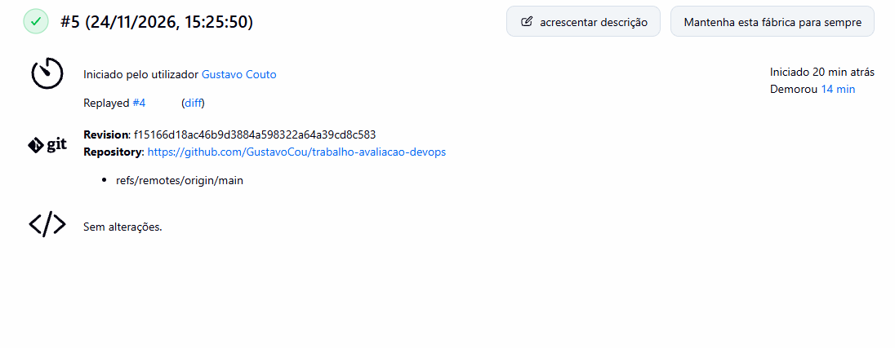
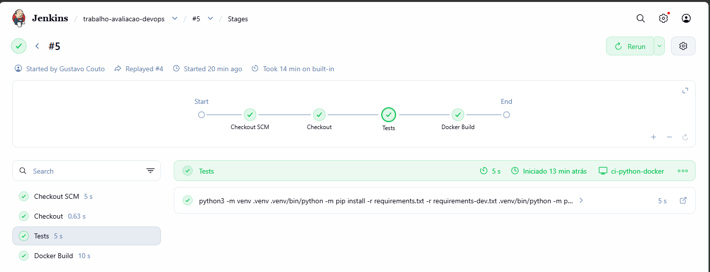
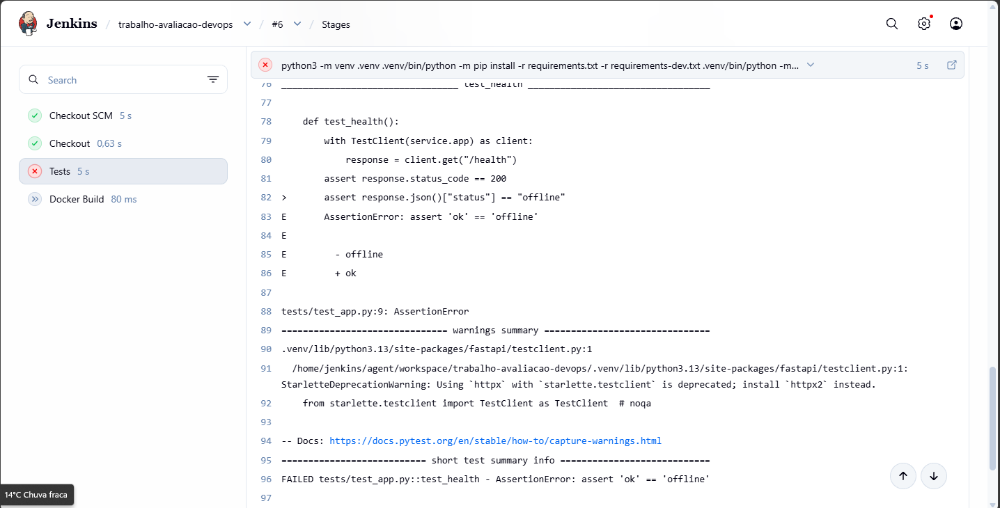
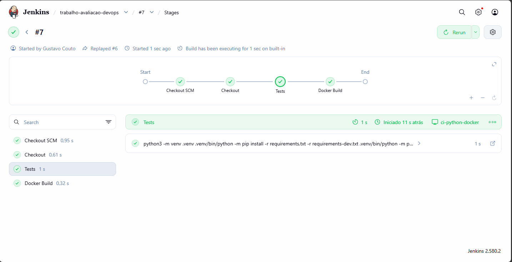

# Relatorio de evidencias - Trabalho Pratico Integrador 01-06

Nome: ___Gustavo Couto___   
Data: ___24/11/2026___

URL do repositorio Git: https://github.com/GustavoCou/trabalho-avaliacao-devops


## Estrutura
- app.py + requirements*.txt + tests/: API FastAPI e testes ja fornecidos.
- Dockerfile + .dockerignore: completar no Exercicio 01.
- compose.yaml: completar no Exercicio 02.
- incidente.yaml: overlay defeituoso para o Exercicio 03 (nao corrigir antes desse passo).
- Jenkinsfile: completar no Exercicio 05.
- RELATORIO.md: evidencias e registo curto a entregar.


## E01 - Ambiente (1 valor)
Comandos e versoes observadas:

| Ferramenta | Versão observada |
|---|---|
| Docker | 29.9.3 |
| Docker Compose | v5.7.1 |
| Git | 2.56.1.windows.1 |

**Evidências de execução:**

```console
PS> docker --version
Docker version 29.9.3, build 5457199

PS> docker compose version
Docker Compose version v5.7.1

PS> git --version
git version 2.56.1.windows.1

PS> docker info
Client:
 Version: 29.9.3
 Context: desktop-linux

Server:
 Server Version: 29.9.3
 Operating System: Docker Desktop
 OSType: linux
 Architecture: x86_64
```

O daemon Docker encontra-se operacional, tendo respondido com sucesso ao comando `docker info` (saída resumida).

## E02 - Dockerfile e container (3 valores)
Tag da imagem; docker ps; HTTP /health; utilizador efetivo do container:


## E02 — Dockerfile e execução de um container

**Construção da imagem:**

```console
PS> docker build -t natixis-support:1.0 .
[+] Building 1.2s (12/12) FINISHED
=> naming to docker.io/library/natixis-support:1.0
```

**Execução do container:**

```console
PS> docker run -d --name tp-api -p 127.0.0.1:18080:8000 natixis-support:1.0

PS> docker ps
CONTAINER ID   IMAGE                 STATUS   PORTS                       NAMES
bc29c2532873   natixis-support:1.0   Up       127.0.0.1:18080->8000/tcp   tp-api
```

**Validação da API:**

```console
PS> curl.exe http://127.0.0.1:18080/health
{"status":"ok","service":"support-api","version":"1.0"}
```

**Validação do utilizador:**

```console
PS> docker exec tp-api id
uid=999(appuser) gid=999(appgroup) groups=999(appgroup)
```

| Parâmetro | Resultado |
|---|---|
| Tag da imagem | `natixis-support:1.0` |
| Porta do host | `18080` |
| Porta do container | `8000` |
| Utilizador | `appuser` (UID 999) |
| Estado da API | `ok` |

**Conclusão:** A imagem foi construída com sucesso e o container executa a aplicação com um utilizador não privilegiado. O endpoint `/health` respondeu corretamente após a inicialização da aplicação.


## E03 - Compose, DNS, healthcheck e volume (4 valores)
Resultado de docker compose config; health; teste checker -> api; contador antes/depois da recriacao:

**Construção e execução dos serviços:**

```console
PS> docker compose up -d --build
[+] Building 1.2s (14/14) FINISHED
[+] up 3/3
 ✔ Image natixis-support:local         Built
 ✔ Network natixis-integrador_default  Created
 ✔ Container natixis-integrador-api-1  Started
```

**Validação do healthcheck:**

```console
PS> docker compose ps
NAME                       SERVICE   STATUS                            PORTS
natixis-integrador-api-1   api       Up 5 seconds (health: starting)   127.0.0.1:18080->8000/tcp

PS> docker compose ps
NAME                       SERVICE   STATUS                    PORTS
natixis-integrador-api-1   api       Up 33 seconds (healthy)   127.0.0.1:18080->8000/tcp
```

**Validação do contador de visitas:**

```console
PS> curl.exe http://127.0.0.1:18080/visits
{"visits":0}

PS> curl.exe -X POST http://127.0.0.1:18080/visits
{"visits":1}

PS> curl.exe http://127.0.0.1:18080/visits
{"visits":1}
```

**Validação da persistência após recriação do container:**

```console
PS> docker compose up -d --force-recreate
[+] up 1/1
 ✔ Container natixis-integrador-api-1 Started

PS> docker compose ps
NAME                       SERVICE   STATUS
natixis-integrador-api-1   api       Up Less than a second (health: starting)

PS> curl.exe http://127.0.0.1:18080/visits
{"visits":1}
```

**Resultados obtidos:**

| Validação | Resultado |
|---|---|
| Construção da imagem | Sucesso |
| Estado do healthcheck | `healthy` |
| Porta do host | `18080` |
| Porta do container | `8000` |
| Contador inicial | 0 |
| Contador após POST | 1 |
| Contador antes da recriação | 1 |
| Contador após a recriação | 1 |
| Persistência dos dados | Confirmada |

**Conclusão:** O serviço API atingiu o estado `healthy` e o contador manteve o seu valor após a recriação do container. Os dados não foram perdidos porque estão armazenados no volume nomeado `app-data`, cujo ciclo de vida é independente do container.


## E04 - Incidente Docker (3 valores)
Sintoma, comandos de investigacao, causa-raiz, alteracao realizada, prova da recuperacao e contador preservado:

### 1. Sintoma

Após a aplicação do ficheiro `incidente.yaml`, o container permaneceu em execução, mas apresentou o estado `unhealthy`.

### 2. Comandos de diagnóstico

```console
PS> docker compose -f compose.yaml -f incidente.yaml ps
NAME                       SERVICE   STATUS                     PORTS
natixis-integrador-api-1   api       Up 4 minutes (unhealthy)   127.0.0.1:18080->8000/tcp

PS> docker compose -f compose.yaml -f incidente.yaml logs --tail 30 api
api-1 | INFO: Started server process [1]
api-1 | INFO: Waiting for application startup.
api-1 | INFO: Application startup complete.
api-1 | INFO: Uvicorn running on http://0.0.0.0:8001 (Press CTRL+C to quit)
```

Através do comando `docker compose -f compose.yaml -f incidente.yaml config`, foram identificados os seguintes valores:

| Componente | Porta configurada |
|---|---|
| Porta de escuta do Uvicorn | 8001 |
| Porta interna do container no mapeamento | 8000 |
| Porta publicada no host | 18080 |
| Porta utilizada pelo healthcheck | 8000 |

### 3. Causa-raiz

O ficheiro `incidente.yaml` alterou a porta de escuta da API de `8000` para `8001`, mantendo o mapeamento de portas e o healthcheck na porta `8000`. Esta incompatibilidade impede o acesso à API através da porta publicada e provoca a falha do healthcheck.

### 4. Correção

Reposição da configuração base, sem aplicar o ficheiro `incidente.yaml`, recriando apenas o serviço `api` e mantendo o volume nomeado.

```console
PS> docker compose up -d --force-recreate api
```

### 5. Validação

Comandos para validar a recuperação do serviço:

```console
PS> docker compose ps
PS> curl.exe -i http://127.0.0.1:18080/health
PS> curl.exe http://127.0.0.1:18080/visits
```

| Validação | Resultado esperado |
|---|---|
| Estado do container | healthy |
| Resposta HTTP | 200 OK |
| Estado da API | ok |
| Contador antes do incidente | 1 |
| Contador após a recuperação | 1 |

A recuperação preserva o volume nomeado `app-data`, permitindo manter os dados independentemente da recriação do container.


## E05 - Git (3 valores)
Branch, hashes de commits, merge e tag v1.0.0:

**Validação do `.gitignore`:**

```console
PS> git check-ignore -v .venv/ .env __pycache__/ .pytest_cache/
.gitignore:1:.venv/          .venv/
.gitignore:5:.env            .env
.gitignore:2:__pycache__/    __pycache__/
.gitignore:3:.pytest_cache/  .pytest_cache/
```

**Commit da aplicação funcional:**

```console
PS> git add .
PS> git commit -m "feat: ambiente integrador funcional"
[main 771c962] feat: ambiente integrador funcional
5 files changed, 114 insertions(+), 23 deletions(-)
```

**Criação da branch de correção:**

```console
PS> git switch -c fix/health-info
Switched to a new branch 'fix/health-info'

PS> git branch
* fix/health-info
  main
```

**Alteração da API (`app.py`):**

```python
@app.get("/health")
def health():
    return {
        "status": "ok",
        "service": os.getenv("SERVICE_NAME", "support-api"),
        "version": "1.0",
        "team": "support"
    }
```

**Asserção acrescentada ao teste `test_health`:**

```python
assert response.json()["team"] == "support"
```


**Commit da alteração:**

```console
PS> git add app.py tests/test_app.py
PS> git commit -m "fix: acrescentar identificacao no health"
[fix/health-info 24023f5] fix: acrescentar identificacao no health
2 files changed, 3 insertions(+), 1 deletion(-)
```

**Integração da branch na principal:**

```console
PS> git switch main
Switched to branch 'main'

PS> git merge fix/health-info
Updating 771c962..24023f5
Fast-forward
 app.py            | 3 ++-
 tests/test_app.py | 1 +
 2 files changed, 3 insertions(+), 1 deletion(-)

PS> git branch --merged main
  fix/health-info
* main
```

**Criação da tag anotada:**

```console
PS> git tag -a v1.0.0 -m "Release integrador 1.0.0"

PS> git tag -n
v1.0.0    Release integrador 1.0.0
```

**Publicação no repositório remoto:**

```console
PS> git push -u origin main
To https://github.com/GustavoCou/trabalho-avaliacao-devops
   75bb0e3..24023f5  main -> main
branch 'main' set up to track 'origin/main'.

PS> git push origin v1.0.0
To https://github.com/GustavoCou/trabalho-avaliacao-devops
 * [new tag] v1.0.0 -> v1.0.0
```

**Validação do histórico e da tag remota:**

```console
PS> git log --oneline --graph --decorate -6
* 24023f5 (HEAD -> main, tag: v1.0.0, origin/main, fix/health-info) fix: acrescentar identificacao no health
* 771c962 feat: ambiente integrador funcional
* 75bb0e3 Initial commit

PS> git ls-remote --tags origin
d6ef0d0fedb0fc6c07f91e48131faa813773d370  refs/tags/v1.0.0
24023f5ec9924d4d825ad6916cff5655642e86b4  refs/tags/v1.0.0^{}
```

**Resultados:**

| Parâmetro | Resultado |
|---|---|
| Branch principal | `main` |
| Branch de correção | `fix/health-info` |
| Hash do primeiro commit | `771c962` |
| Hash do segundo commit | `24023f5` |
| Merge | Fast-forward |
| Tag anotada | `v1.0.0` |
| Publicação do histórico | Confirmada |
| Publicação da tag | Confirmada |
| Testes automatizados | Validação pendente |

**Repositório:** [trabalho-avaliacao-devops](https://github.com/GustavoCou/trabalho-avaliacao-devops)

**Conclusão:** A branch de correção foi integrada com sucesso na branch principal através de um merge fast-forward. O histórico de commits e a tag anotada `v1.0.0` foram publicados no GitHub.

## E06 - Jenkins SUCCESS (4 valores)
URL/numero do build, etapas e identificador da imagem construida:


| Parâmetro | Resultado |
|---|---|
| Número do build | #5 |
| URL do build | [Build #5](http://127.0.0.1:8080/job/trabalho-avaliacao-devops/5/) |
| Data de execução | 24/11/2026 às 15:25:50 |
| Duração | 14 minutos |
| Agente (label) | `ci-python-docker` |
| Commit | `f15166d` |
| Branch | `main` |
| Checkout | SUCCESS |
| Tests | SUCCESS — 2 testes aprovados |
| Docker Build | SUCCESS |
| Tag da imagem | `natixis-support:ci-5` |
| Estado final | SUCCESS |

**Identificador da imagem construída:**

```text
sha256:967544b9f2051e5e1293bbf19dc0f674b1940038d7c160b9bc2df2022c769c73
```

**Evidência 1 — Resultado do build:**




**Evidência 2 — Etapas da pipeline:**



**Evidência 3 — Execução dos testes automatizados:**

```console
+ python3 -m venv .venv
+ .venv/bin/python -m pip install -r requirements.txt -r requirements-dev.txt
+ .venv/bin/python -m pytest -q

..                                                        [100%]
2 passed, 1 warning in 0.15s
```

Os dois testes foram executados com sucesso. Foi apresentado um aviso
de descontinuação relacionado com a utilização de `httpx` pelo
Starlette TestClient, sem comprometer o resultado dos testes.

**Evidência 4 — Construção e inspeção da imagem Docker:**

```console
+ docker build -t natixis-support:ci-5 .

Successfully built 967544b9f205
Successfully tagged natixis-support:ci-5

+ docker image inspect natixis-support:ci-5 --format {{.Id}}
sha256:967544b9f2051e5e1293bbf19dc0f674b1940038d7c160b9bc2df2022c769c73
```

**Conclusão:** A pipeline de integração contínua executou com sucesso
as etapas Checkout, Tests e Docker Build. Os dois testes automatizados
foram aprovados e a imagem Docker foi construída e validada através
do comando `docker image inspect`, garantindo a rastreabilidade da
execução.


## E07 - Jenkins FAILURE e recuperacao (2 valores)
Build FAILURE, etapa que falhou e excerto relevante do log; build SUCCESS apos correcao:

### Falha intencional — Build #6

Foi alterada intencionalmente a asserção do teste `test_health`
para provocar uma falha na etapa de testes automatizados.

```python
assert response.json()["status"] == "offline"
```

**Resultado da execução:**

```console
+ .venv/bin/python -m pytest -q

F.                                                          [100%]

FAILED tests/test_app.py::test_health
AssertionError: assert 'ok' == 'offline'

1 failed, 1 passed, 1 warning in 0.15s
script returned exit code 1
```

**Evidência da falha:**



### Correção e recuperação — Build #7

Foi reposto o valor esperado na asserção do teste `test_health`.

```python
assert response.json()["status"] == "ok"
```

Após a correção, foi realizada uma nova execução da pipeline,
tendo todas as etapas terminado com sucesso.

**Evidência da recuperação:**


### Comparação das execuções

| Parâmetro | Build #6 | Build #7 |
|---|---|---|
| URL | [Build #6](http://127.0.0.1:8080/job/trabalho-avaliacao-devops/6/) | [Build #7](http://127.0.0.1:8080/job/trabalho-avaliacao-devops/7/) |
| Checkout | SUCCESS | SUCCESS |
| Tests | FAILURE | SUCCESS |
| Docker Build | SKIPPED | SUCCESS |
| Estado final | FAILURE | SUCCESS |

**Conclusão:** A pipeline detetou corretamente a falha intencional
do teste, impedindo a execução da etapa Docker Build. Após a correção,
a pipeline voltou a executar todas as etapas com sucesso, demonstrando
a eficácia dos testes automatizados como mecanismo de controlo de
qualidade (Quality Gate).

## Verificacao final
[X] Dockerfile 
[X] compose.yaml 
[X]app.py 
[X] tests/ 
[X] Jenkinsfile
[X] Historico Git 
[X] Tag v1.0.0 
[X] Evidencias E01-E07
